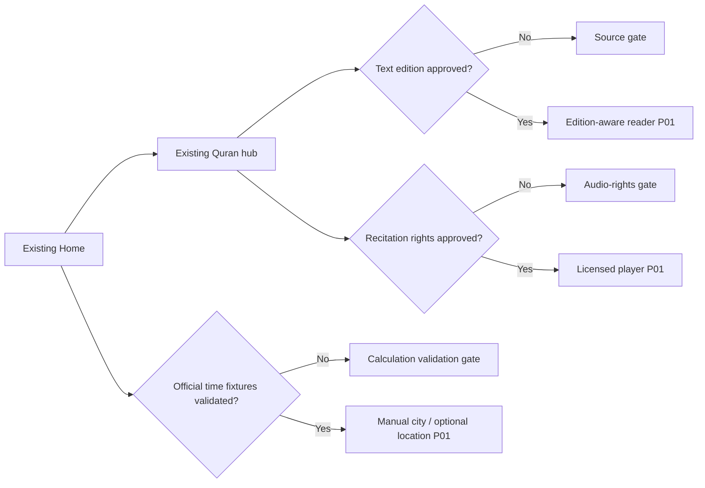

# P00-04 — Bilingual UX wireframes

**No redesign of the brand or existing app shell.** Owner approved the existing **مدار الهدى / Madar Al-Huda** name and orbit/book icon on 2026-11-22. Existing original logo and assets are in [design/brand](../../design/brand/); P00-06 existing Flutter Home, hubs, navigation and bilingual localization remain authoritative. This work supplies **forward-looking editable wireframes**, not duplicate screens.

## Screen pairs (SVG source, 390×844)

| Existing Flutter route | Arabic RTL | English LTR | Actual implementation |
|---|---|---|---|
| `/home` | [AR](wireframes/home-ar.svg) | [EN](wireframes/home-en.svg) | Already implemented; keep existing HomeScreen |
| `/quran` | [AR](wireframes/quran-ar.svg) | [EN](wireframes/quran-en.svg) | Existing hub; source-gated cards |
| `/quran/read` | [AR](wireframes/reader-ar.svg) | [EN](wireframes/reader-en.svg) | Placeholder; future P01-01/02/03 |
| `/quran/recitations` | [AR](wireframes/player-ar.svg) | [EN](wireframes/player-en.svg) | Placeholder; future P01-06 |
| `/worship/prayer-times` | [AR](wireframes/prayer-ar.svg) | [EN](wireframes/prayer-en.svg) | Placeholder; P00-10/P01-07 |
| `/library` | [AR](wireframes/library-ar.svg) | [EN](wireframes/library-en.svg) | Existing hub; publication-gated |
| `/learning` | [AR](wireframes/learning-ar.svg) | [EN](wireframes/learning-en.svg) | Existing hub; publication-gated |

These are *structural sketches*, not proof that the eventual screens work on-device. Names are original UI labels; there are no Quran verses, hadith, audio files, or computed prayer times.

## Behavior and accessibility contract

- Preserve `StatefulShellRoute.indexedStack` and its five tab destinations, including tab-specific history and switching back to tab root. Existing `apps/mobile/lib/core/routing/app_routes.dart` remains the route source of truth. On Arabic RTL, the Home tab appears on the far right; on English LTR it appears on the far left. Logo does **not** flip.
- **Home:** reuse the working greeting, device-formatted date and quick access; do not add a countdown, verse, or real prayer time until permissions/gates pass.
- **Reader:** edition-aware `AyahRef` (edition id + surah + ayah) from the existing contract, and no fabricated text. Search/last-read/bookmarks are P01; display a source gate until a validated immutable edition is approved.
- **Player:** no fake playable audio. Streaming vs caching/download rights require separate approvals; show an inert audio-rights gate until then.
- **Prayer:** city selection must work without GPS, followed by method, Asr school, time zone and optional adjustments. All expected values must come from official sources (P00-10); `--:--` is a placeholder, *not* a calculation.
- **Library & Learning:** citation and grade/source presentation, editorial/scholarly approvals and local-first progress are later implementations, not inferred from sketch.
- Layout: start-aligned text according to locale; directional chevrons and padding; 48 dp targets; 2× text scaling; WCAG AA light/dark; proper TalkBack headings and focus order. >=600dp retains the existing NavigationRail, not a separate design system.
- All text belongs in ARB resources **when screens are implemented**, not hardcoded into Flutter. No new user-facing runtime strings were added by this design PR.

## Basic flow and handoff

### Evidence for P00-04
- This folder contains 14 editable SVGs: 7 views × 2 languages.
- Run `python3 docs/ux/check_wireframes.py` (also integrated in existing Secrets & policy CI job).
- Manual review on a real device and 2× text size is **not claimed**. Compare with earlier [P00-06 CI screenshots](../screenshots/p00-06/) before implementing future screens.
